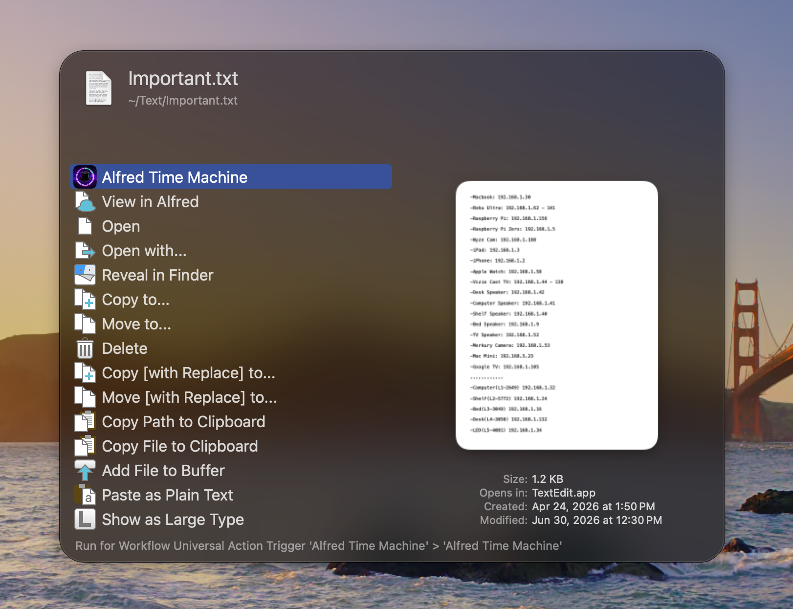
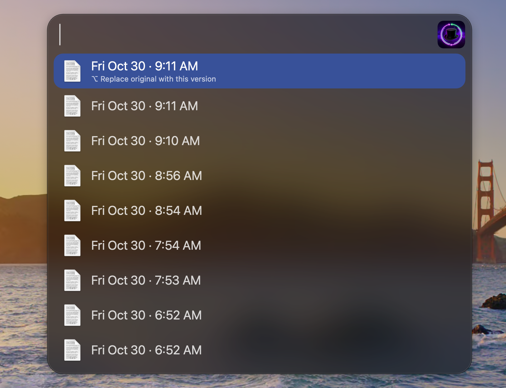

# Alfred Time Machine 

Instant file & app restoration from Time Machine backups, right from Alfred. No slow UI, no spinning stars.

<div align="center">
  
  &nbsp;&nbsp;&nbsp;&nbsp;
  
</div>

## How it Works

**Alfred Time Machine** is a high-speed restoration tool for macOS:

1.  **`alfred-tm` binary** — A compiled Swift CLI that instantly scans your Time Machine backups (both external drives and local APFS snapshots) to find historical versions.
2.  **Alfred Workflow** — A clean, fast picker UI for your Universal Actions.

Everything runs locally on your Mac. The workflow makes no network calls and sends nothing anywhere.

## Installation

### Requirements

- macOS with Time Machine set up (local snapshots work even with no backup disk attached)
- Alfred 5 with the Powerpack license (Universal Actions are a Powerpack feature)
- Full Disk Access for Alfred (see below)

### Option 1: Download from Releases (Recommended)

1. Download the latest [`AlfredTimeMachine.alfredworkflow`](https://github.com/saihgupr/AlfredTimeMachine/releases/download/v1.2.0/AlfredTimeMachine.alfredworkflow) from [Releases](https://github.com/saihgupr/AlfredTimeMachine/releases/latest).
2. Double-click `AlfredTimeMachine.alfredworkflow` to import it into Alfred.
3. **Full Disk Access**: Time Machine requires **Full Disk Access**. Go to `System Settings > Privacy & Security > Full Disk Access` and ensure **Alfred** is enabled.

### Option 2: Build from Source

```bash
git clone https://github.com/saihgupr/AlfredTimeMachine.git
cd AlfredTimeMachine
bash deploy.sh
```

### Full Disk Access (Required)

Alfred needs **Full Disk Access** or the version list comes up empty and restores fail. Enable it under `System Settings > Privacy & Security > Full Disk Access`, then restart Alfred.

macOS updates can silently revoke the permission. If restores worked and suddenly stop after an update, remove Alfred from the list, re-add it, and restart Alfred.

## Usage

### Via Universal Actions (Recommended)

1.  In **Finder**, click any file or application to select it.
2.  Press your **Alfred Universal Actions hotkey** (default: `⌥→`).
3.  Search for **"Alfred Time Machine"**.
4.  Browse the versions found:
    - **External Drive** — Backups from your Time Machine disk.
    - **Local Snapshot** — Recent backups stored on your internal drive (last ~24h).
5.  Pick a version and press **↩ Enter** to restore (see shortcuts below for Home folder and in-place options).

### Keyboard Shortcuts

| Key | Action |
| :--- | :--- |
| `↩ Enter` | Restore as `(Restored)` next to the original |
| `⌘↩ Enter` | Restore a copy to your Home folder instead |
| `⌥↩ Enter` | Replace original in place with this version (no undo) |

---

## Advanced

### CLI Usage

You can use the binary directly from your terminal:

```bash
# List all versions
./alfred-tm list "/path/to/file"

# Restore a specific version
./alfred-tm restore "/source/backup/path" "/original/path" [--home | --replace]
```

### Automatic "Damaged" App Fix
Alfred Time Machine automatically handles Gatekeeper issues when restoring `.app` bundles. It clears quarantine flags, strips restrictive Time Machine ACLs, and performs ad-hoc signing so restored apps open immediately.

---

## Troubleshooting

- **"Apple could not verify alfred-tm is free of malware" on install** — Expected for the GitHub Release download: the binary is ad-hoc signed, and macOS quarantines downloaded files. Verify you downloaded from [Releases](https://github.com/saihgupr/AlfredTimeMachine/releases/latest), then clear the quarantine flag on your own copy and verify:
  ```bash
  xattr -d com.apple.quarantine alfred-tm
  codesign -dv alfred-tm
  spctl -a -vv alfred-tm
  ```
  Or Right-click the workflow / binary > Open to approve once. Proper Developer ID signing + notarization is planned to remove this prompt. Never disable Gatekeeper globally (`spctl --master-disable`).
- **No versions found, but backups exist** — Alfred lost Full Disk Access (see above). If access is granted and the list is still empty, that file genuinely has no backup copies yet.
- **Restore fails** — Same cause 9 times out of 10. Re-enable Full Disk Access for Alfred and restart it.
- **Restored copy lands in your Home folder instead** — The original folder is read-only or permission denied, so the workflow falls back to Home rather than failing.
- **Replaced the wrong version with ⌥↩?** — There is no undo. Check `/tmp/alfred-tm-restore.log` to see exactly which backup was used, then restore the right one over it.

---

## Contributing & Support

If you run into a bug, have an idea for a feature, or want to ask a question, feel free to open an [issue](https://github.com/saihgupr/AlfredTimeMachine/issues/new/choose). Pull requests are also warmly welcome!

Like it? Star it on GitHub ⭐. Love it? Feel free to buy me a [Ko-fi ☕️](https://ko-fi.com/saihgupr).